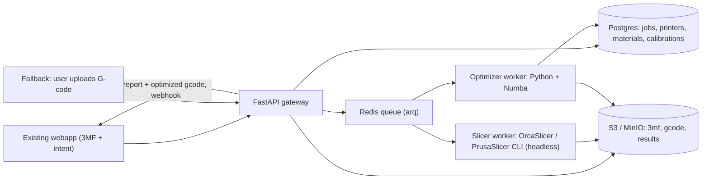
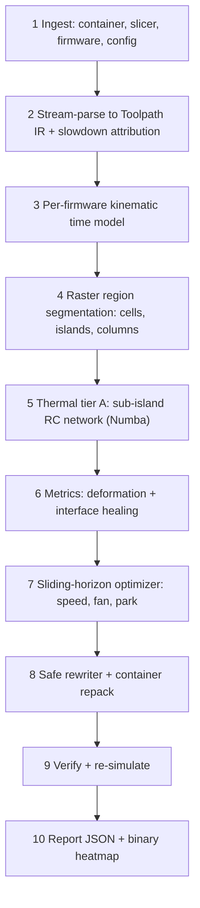

# Thermal G-code Optimizer: Backend Plan (v2, final)

> [!NOTE]
> v2 builds in a critical review by a Gemini Pro model. Section 10 lists what changed and why. UI is out of scope. Every component here is backend.

## 0. Goal, positioning, evidence

**Product:** a backend service next to your FDM design webapp. It takes a part and its print settings, simulates where heat builds up, and produces G-code with **locally optimized speed and fan schedules**. That replaces the "slow down the whole layer" heuristic of minimum layer time.

**Testable research question:** *Can a fast, region-resolved thermal model shorten print time compared with minimum-layer-time control, without losing geometric accuracy or interlayer strength?*

**Evidence (verified sources):**
| Source | What it shows | Limitation |
|---|---|---|
| Driezen & Herrmann, *Rapid Prototyping J.* 28(8):1492–1508, 2022 | Thermal simulation (Abaqus) finds hotspots, adapts local nozzle speed, regenerates G-code. Validated with ABS on an Ultimaker S5. | Slow FEA. Shows no time savings versus modern slicers. |
| Gamdha et al. (Iowa State), *Finite Elements in Analysis & Design* 2025 / arXiv | G-code → voxel transient simulation on adaptive octrees, faster than real time | Fan/extrusion control is only future work |
| *FD Modeling & Experimental Investigation of Cyclic Thermal Heating in FFF*, 2024 (PubMed 39359581) | GPU-friendly finite-difference model validated with IR | Model only, no optimizer |
| Mueller et al., *3D Printing & Additive Manufacturing*, 2023 | Feature-specific cooling improved tensile strength of PEEK | Used custom directed-air hardware, not a stock part fan. Gains on stock printers will likely be smaller. |
| Helio Additive (commercial, in Bambu Studio / OrcaSlicer) | Voxel thermal analysis plus G-code speed "Enhance" | Closed source, paid, cloud. A direct competitor. |

**Differentiators (why build this instead of using Helio):**
1. **Owning the design → slice → optimize chain.** Your webapp already has the 3MF, so you can slice under controlled settings (§3.1) instead of guessing the user's intent from G-code.
2. **Design intent.** The webapp knows which faces are cosmetic, load-bearing or dimension-critical.
3. **Open, explainable models**, with calibration per printer.

> [!WARNING]
> Biggest product risk: on prints limited by flow or acceleration (most large parts), gains will be small. The optimizer only pays off on **cooling-limited** prints: small, tall or multi-feature parts. That is why validation comes before building the optimizer (§8, P1).

---

## 1. Architecture



**Two entry modes:**
| Mode | Input | Baseline quality | Notes |
|---|---|---|---|
| **A. Controlled slicing (recommended)** | 3MF from the webapp, plus printer and filament profiles | Clean: the service slices with layer-time slowdown **disabled** and keeps every geometric slowdown (overhangs, bridges, small perimeters) | The service fully controls the "intended" speeds |
| **B. Uploaded G-code (fallback)** | `.gcode` / `.bgcode` / `.gcode.3mf` | Inferred: the service must attribute each slowdown to a cause (§3.2) | Higher risk. Conservative mode only. |

Pipeline inside the optimizer worker:



---

## 2. Tech stack

| Concern | Choice | Notes |
|---|---|---|
| API | Python 3.12, **FastAPI**, Pydantic v2 | REST + webhooks to the webapp |
| Jobs | **arq** + Redis (or Celery) | Separate queues for slicing and optimization |
| DB / files | Postgres, S3/MinIO | Pre-signed upload URLs for large G-code |
| Slicing | **OrcaSlicer CLI** and/or **PrusaSlicer CLI** in Docker (headless) | Version-pinned. Mode A depends on it. |
| Numerics | NumPy + **Numba** | Tier A and kinematics. Move hot paths to Rust/C++ only if profiling demands it. |
| Geometry | **Numba raster / spatial hash** (no per-segment Shapely unions) | Shapely only for small post-processing jobs, such as island outlines in the report |
| 3MF | **lib3mf** (Python bindings) | Read and write the custom intent namespace |
| `.bgcode` | `libbgcode` (C++17, built via CMake in the Docker image) | Deferred: v1 accepts ASCII G-code from Prusa printers |
| Kinematics reference | `pyGCodeDecode` (MIT) **for Marlin-style jerk / junction deviation only** | Klipper (`square_corner_velocity`, `minimum_cruise_ratio`) and Bambu need their own implementations |
| GPU voxel tier | **Deferred** (Taichi later) | Only after tier A is validated |
| Tests | pytest, Hypothesis, golden fixtures per slicer version | |

---

## 3. Low-level design

### 3.1 Ingest
- **Containers:**
  - `.gcode`.
  - `.gcode.3mf` (unzip `Metadata/plate_N.gcode`, read settings from `Metadata/project_settings.config` as JSON).
  - `.bgcode` (later).
- **Slicer detection:** from header comments.
- **Config extraction:** location differs by slicer. PrusaSlicer/Orca ASCII G-code puts the `; key = value` block at the **end**. Bambu Studio places a `CONFIG_BLOCK_START…END` block near the **top**. ⚠️ Verify this per slicer version with fixtures before relying on it.
- **Firmware flavor:** Marlin, Klipper, RRF or Bambu. It selects the kinematics and fan command dialect.
- **Hard requirement:** feature-type comments (`;TYPE:` / `; FEATURE:`). Reject files without them.

### 3.2 Toolpath IR + slowdown attribution
Stream-parse into NumPy chunks (bounded memory). Struct-of-arrays, one row per segment:
```
seg_id, layer, z, x0,y0,x1,y1, e, width, height, feature,
F_file, F_intended, slowdown_cause, object_id, island_id,
fan_cmds, pa_value, is_travel, is_retract, tool_id
```
- Expand G2/G3, track relative/absolute E, G10/G11, `M201/M203/M204`, `SET_VELOCITY_LIMIT`, `M900`/`SET_PRESSURE_ADVANCE`, `M106 P*`/`SET_FAN_SPEED`, `T*`/`M620` (multi-material).
- **`slowdown_cause` (critical in mode B):** for each segment where `F_file` < the configured feature speed, classify the cause:
  - `overhang`: by geometry, from how far the segment hangs past the layer below.
  - `bridge`, `small_perimeter` (loop length below the threshold), `volumetric_cap` (F × w × h ≈ the cap), `layer_time` (a uniform scale across the layer).
  - `unknown` → **never touched**.

  Only `layer_time` slowdowns may be lifted. In mode A this step is trivial, because layer-time slowdown is disabled at slice time.

### 3.3 Kinematic time model
- Per-firmware planner with look-ahead and trapezoidal profiles:
  - Marlin: jerk or junction deviation.
  - Klipper: `square_corner_velocity`, `minimum_cruise_ratio`.
  - Bambu: approximate, calibrated against the printer's own estimates.
- Output per segment: `t_start`, `t_end`, the velocity profile, and the dwell time spent above each raster cell.
- Target: under 3% total time error against real prints (measured, not assumed).

### 3.4 Region segmentation (raster, not polygon unions)
- Per layer: rasterize extrusion into a **2D grid of 0.5–1 mm cells** (Numba line rasterizer weighted by width). Record each cell's deposited mass, deposition times and feature type.
- **Islands** = connected components of occupied cells. **Columns** = islands linked across layers by cell overlap (union-find). The thin pin and the thick pin become separate columns.
- Thermal nodes = **coarse cells (2–4 mm)** within islands. Small islands (pins) stay one node or a few, while big islands get many nodes. This avoids smearing local heat over a whole island.

### 3.5 Thermal tier A: sub-island RC network
Per node *i* (one coarse cell, one layer):

$$ C_i(T)\frac{dT_i}{dt} = \dot Q_{dep,i} + \sum_{j} G_{ij}(T_j - T_i) - h_i(t)\,A^{exp}_i (T_i - T_{amb}(z)) - \varepsilon\sigma A^{exp}_i (T_i^4 - T_{amb}^4) + \dot Q_{noz,i}(t) $$

- $C_i(T) = m_i c_p(T)$, a temperature-dependent heat capacity. For semi-crystalline polymers (PA, PETG is amorphous, PEEK, PP) add the **latent heat of crystallization** as an effective $c_p$ peak.
- $\dot Q_{dep}$ is applied **when and where** beads land, at the temperature of the **deposited melt**: $T_{melt} = T_{set} - \Delta T(\text{flow})$, using a per-hotend calibrated drop at high volumetric flow.
- $G_{ij}$: in-plane conduction, plus vertical conduction with a **bead-to-bead contact resistance** (Z conductance below bulk), plus bed conduction at layer 0.
- $h_i(t)$: the fan **as experienced by the node**. It depends on fan PWM after a first-order **spin-up/down lag** (τ about 0.5–1.5 s, calibrated), on distance from the nozzle (airflow decays sharply once the toolhead moves away), and on duct direction.
- $T_{amb}(z)$: a stratified ambient profile (bed plume, chamber), calibrated per enclosure type.
- $\dot Q_{noz}$: radiative/convective reheating from the hot block and nozzle while it is over or near the node.
- Solver: implicit, event-driven, sparse. Keep only the top K layers (about 20–30) at full resolution and lump older layers.
- **Interface sub-model (for bonding):** for each newly deposited node, a 1D two-layer contact solution on top of its parent node gives the **interface temperature history** $T_{int}(t)$ during the seconds after deposition. A lumped node cannot resolve this spike.

### 3.6 Metrics & constraints
Replaces the contradictory "T_bond_min before next bead" from v1.

| Metric | Definition | Constraint |
|---|---|---|
| **Deformation** | $T_{sub}$ of a node when the next bead lands on it, plus time above $T_{deform}$ | $T_{sub} \le T_{deform,max}$ (near Tg/HDT, empirically calibrated per material) |
| **Interface healing** | $H = \int dt / \tau_{rep}(T_{int}(t))$ while $T_{int} > T_g$ (or above $T_c$ for semi-crystalline polymers), with $\tau_{rep}$ from an Arrhenius/WLF fit | $H \ge H_{min}$. Stricter on load-path regions (intent metadata). |
| **Overhang reheating** | Peak $T$ on overhang/bridge nodes | Stricter limit |
| **Visual consistency** | Speed change on outer walls between layers, VFA forbidden speed bands | $\Delta F \le k\%$, and F never inside a forbidden band |
| **Hotend capacity** | F × w × h | ≤ `max_volumetric_speed`, with nozzle-temperature headroom |

Material DB: ρ, $c_p(T)$, k, ε, Tg, $T_c$/ΔH_c, $T_{deform,max}$, WLF/Arrhenius parameters, recommended temperatures. **Every value stores its source and a confidence level.** ⚠️ The parameters behind the healing model are scarce for consumer filaments. Expect to calibrate them from tests.

### 3.7 Optimizer: sliding horizon
**Variables:**
- A speed scale per (column × feature × layer) group, within [min_speed, `F_intended`]. Segments with `slowdown_cause` ∈ {overhang, bridge, small_perimeter, unknown} are **frozen**.
- The fan PWM schedule (per fan channel).
- Optional **cooling park / sacrificial tower** moves.
- **Excluded in v1:** island reordering (§3.7.3).

**Algorithm:**
1. Sliding horizon of K = 5–10 layers. Solve layers n…n+K, commit layer n, slide. This catches multi-layer heat build-up, such as tapered pins.
2. The objective is to minimize the time of the horizon, plus λ·(ΔF penalties on outer walls), plus μ·(fan-change count). The smoothing lives **inside** the objective, not as a later pass, so it cannot break constraints.
3. Solver: start with a **heuristic projected-gradient / greedy-repair loop** (simulate → find violated nodes → apply the cheapest fix → re-simulate, max 3–5 iterations per horizon). Fixes in order of cost:
   - (a) Fan boost scheduled `spinup_lead` ahead.
   - (b) Slow **other** islands so the hot one gets more air time.
   - (c) Slow the hot island itself, only if the model says nozzle reheating is not dominant.
   - (d) Cooling park or sacrificial tower.
4. Relax first: begin from `F_intended` (no layer-time slowdown). Time is saved wherever the constraints already hold.

**3.7.1 Fan specifics.**
- The part fan is usually **global**, so "local cooling" means time-scheduled cooling.
- Ignore fan changes shorter than about 2τ (they never settle).
- Respect firmware kick-start behavior on S0 → S>0. Never drop to 0 mid-layer.
- Multi-fan machines (Bambu aux/chamber fans, `M106 P2/P3`) expose extra channels.

**3.7.2 Never touch:**
- Layers 0–1 (adhesion).
- Travel moves.
- Wipe/ironing.
- Prime/purge towers.
- Any segment with an unknown slowdown cause.

**3.7.3 Island reordering (deferred, research track).** Reordering breaks:
- slicer collision/travel planning,
- seams and wipes,
- `EXCLUDE_OBJECT`/`M486` blocks,
- AMS/multi-material sequencing (extra swaps and purge).

If attempted later, limit it to single-material, same-object islands, with travel-collision checks and seam preservation. Only in mode A, and ideally by passing a sequence hint back into the slicer rather than editing G-code.

### 3.8 Safe rewriter
- Change only `F` and insert fan commands. Never change geometry, E or temperatures in v1.
- Split a segment where the speed must change mid-move.
- **Adaptive pressure advance:** if the file contains PA changes tied to speed or flow (OrcaSlicer adaptive PA), re-emit the PA for the new speed from the slicer's PA table. If no table is available, do not change the speed by more than ±X% on those segments.
- **Recompute `M73`** (progress and remaining time) from the new kinematic timeline.
- **Container repack:**
  - `.gcode.3mf`: rewrite `plate_N.gcode`, regenerate `plate_N.gcode.md5`, update the print time and weight in `slice_info.config`. ⚠️ Exact md5 formatting (for example trailing newline handling) must be checked against real printer acceptance tests.
  - `.bgcode`: re-encode blocks (later).
- Header comment: optimizer version, model/calibration hash, time before → after.

### 3.9 Verification
- Total E unchanged per layer. Segment geometry identical. Bounding box identical.
- F ≤ machine limits. Volumetric flow ≤ cap. No outer-wall F inside a VFA band.
- Re-run tier A on the output. Before/after violations must not get worse anywhere.
- Fail-safe: if verification fails, return the original file plus an explanation.

### 3.10 Report (for the future UI)
- Totals: time before/after, a breakdown of what limits each print (cooling / flow / acceleration), and violations before/after.
- Per node: $T_{sub}$, healing index H, the deformation margin, the action taken.
- Binary sidecar: a per-segment float16 array for temperature/margin, for 3D heatmap coloring.
- `confidence`: derived from the calibration status of the printer and material.

---

## 4. 3MF design intent (webapp → service)
Custom namespace, for example `xmlns:fdmx="https://yourapp/ns/fdm-intent/1"`:
- `fdmx:surfaceClass` = cosmetic | functional | hidden. Sets the allowed ΔF on visible walls.
- `fdmx:loadPath` = z-critical. Raises $H_{min}$ (bonding) for those regions.
- `fdmx:dimensionalCritical`. Tightens $T_{deform,max}$.

**Matching:** in mode A the service slices the 3MF itself, so mapping is exact. In mode B, register objects by object labels plus bounding-box/centroid matching (slicers re-center and arrange plates, so transforms alone are unreliable).

---

## 5. API (v1)
```
POST /v1/jobs
  mode_input = "3mf" | "gcode"
  files (pre-signed S3 upload), printer_profile_id, filament_id
  action = "assess" | "optimize"
  objective = "time" | "balanced" | "quality"
GET  /v1/jobs/{id}            status, progress, stage
GET  /v1/jobs/{id}/report     JSON
GET  /v1/jobs/{id}/heatmap    binary sidecar
GET  /v1/jobs/{id}/gcode      optimized file (original container format)
CRUD /v1/printers  /v1/filaments  /v1/calibrations
Webhook: job.completed / job.failed
```

---

## 6. Calibration (per printer family / material)
- **Printer:** a calibration print (thin + thick pins, tower array) with a thermocouple-instrumented bed or an IR camera. Fit the fan $h$(PWM, distance), the spin-up τ, $\dot Q_{noz}$, $T_{amb}(z)$ and the melt drop ΔT(flow).
- **Material:** datasheet values, plus a sag test (thin pins at decreasing layer times) to find $T_{deform,max}$, plus Z-tensile bars at known thermal histories to fit the healing threshold $H_{min}$.
- Store the results as versioned calibration records. Reports state which calibration was used.

---

## 7. Benchmark protocol (validation)
Compare, under identical conditions:
1. Stock OrcaSlicer with `dont_slow_down_outer_wall` enabled (the strongest current heuristic).
2. Tier A speed + fan optimization.
3. (Later) the optimization plus reordering or sequence hints.

Test parts: a thin + thick pin pair, a thick base tapering to a thin tip, a multi-branch part, plus one big flow-limited part as a control.

Metrics: real print time, dimensional error, curl/sag, gloss uniformity, Z-tensile strength, and IR-measured temperatures against predictions.

---

## 8. Roadmap (validation first)
| Phase | Deliverable | Exit criterion |
|---|---|---|
| **P0** | Stream parser, IR, slowdown attribution, per-firmware kinematics, mode A slicer worker | Under 3% time error on fixtures |
| **P1** | **Empirical go/no-go:** IR/thermocouple study on 2–3 parts. Tier A prototype vs measurements. Estimate the achievable time savings vs `dont_slow_down_outer_wall`. | Model error inside a set band, plus meaningful savings on cooling-limited parts. **Stop or pivot if not.** |
| P2 | "Assess" report (analysis only, no G-code changes) through the API | Useful hotspot prediction |
| P3 | Speed optimizer + safe rewriter + verification (mode A first) | Benchmark: faster at equal quality |
| P4 | Fan scheduling, park/tower, multi-fan, `.gcode.3mf` repack, mode B | Printer acceptance tests pass |
| P5 | 3MF intent, healing metric tuned, GPU voxel tier B for hotspots, reordering research | |

---

## 9. Risks
| Risk | Mitigation |
|---|---|
| Small gains on flow- or accel-limited prints | The report classifies what limits each print. Positioning targets cooling-limited parts. |
| Model inaccuracy without calibration | Confidence flags, conservative defaults, P1 go/no-go |
| Slicer/firmware format drift | Pinned CLI versions, fixture suite per version |
| Upload friction (G-code files of 50–500 MB) | Mode A (slice server-side from the webapp's 3MF) as the main path. Later, an optional local post-processing script that calls the API. |
| Competition (Helio in Bambu Studio and Orca) | Differentiate on design intent, owning the pipeline, and openness |
| IP/patents | ⚠️ Not assessed. Do a patent search (e.g. Helio Additive) before commercial launch. |

---

## 10. What changed after the Gemini Pro review
| Review point | Accepted? | Change |
|---|---|---|
| `T_bond_min` before the next bead is physically wrong (the substrate cools below Tg on normal layers; bonding happens during the post-deposition spike) | ✅ | Replaced with an interface-healing metric and a 1D interface sub-model (§3.5, §3.6) |
| Lumped island nodes smear local peaks; missing melt temperature drop, $c_p(T)$, latent heat, contact resistance, stratification, fan decay | ✅ | Sub-island nodes plus each term added (§3.4, §3.5) |
| Restoring config speeds would also undo overhang, small-perimeter and volumetric slowdowns | ✅ | Slowdown attribution, frozen segments, and mode A slicing with only layer-time slowdown disabled (§1, §3.2) |
| Rewriting F breaks adaptive PA, M73, `.gcode.3mf` md5/metadata, VFA | ✅ | Safe rewriter rules (§3.8, §3.9). Exact md5 formatting flagged for testing. |
| Bambu config block at the top / JSON in 3MF | ✅ (to verify) | §3.1, with a fixture check |
| Island reordering hazards | ✅ | Deferred to a research track (§3.7.3) |
| Calibration at P4 is too late | ✅ | P1 empirical go/no-go (§8) |
| Business friction / competing with Helio | ✅ | Mode A server-side slicing from the webapp's 3MF as the main path (§1) |
| Shapely too slow; pyGCodeDecode does not model Klipper | ✅ | Raster segmentation; per-firmware planners (§2, §3.3, §3.4) |
| Greedy per-layer is myopic; smoothing after the fact breaks constraints | ✅ | Sliding K-layer horizon with penalties inside the objective (§3.7) |
| Fan lag / kick-start, off-part cooling park | ✅ | §3.7.1, fix (d) |
| Defer Taichi; libbgcode build cost | ✅ | Deferred (§2) |
| Mueller et al. used custom air hardware | ✅ | Noted in the §0 evidence table |
